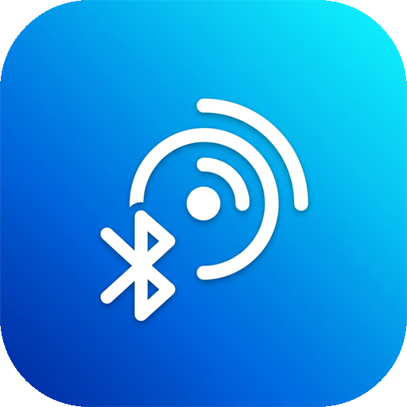

<p align="center">
  
</p>

<h1 align="center">AirTether</h1>

通过低功耗蓝牙（BLE GATT）在 Windows 电脑上远程开关 Android 手机热点、实时同步手机蜂窝网络状态，并支持 Windows 原生来电提醒（拒接 / 静音）。

## 核心功能

### 手机端（Android / Kotlin，`android/`）
- **BLE GATT Server + 广播**：作为外设广播服务 UUID，支持多设备状态通知（Notify）与 MTU 适配。
- **双模式热点控制**：同时支持 **Shizuku**（免 Root，UID 2000 `shell`）和 **Root（`su`）** 开关便携式 Wi-Fi 热点，支持自动选择或手动切换。
- **实时状态监测**：实时采集并上报移动网络信号强度（0~4 格）、网络制式（2G/3G/4G/5G/无服务，兼容 5G NSA）、热点开关状态、热点 SSID 与电池电量。
- **来电监听与控制**：监听来电响铃/接听/挂断状态并推送给电脑，响应电脑端的 **拒接** 与 **静音** 指令。

### 电脑端（Windows .NET 9 WPF，`windows/`）
- **Win10 风格双托盘图标**：
  - **网络制式图标**：独立显示 `5G` / `4G` / `3G` / `2G`（右键支持自定义显示文本或恢复跟随手机）。
  - **信号格图标**：独立显示 4 格移动信号；未连接手机时信号格清零并在右下角显示 Win10 风格红色 `×`，热点未开启时右下角同样显示 `×`。
- **Win10 风格右下角 Flyout 控制面板**：深色半透明质感，精确定位在任务栏上方，失焦自动收起；可查看连接状态、信号、网络制式、电量与热点 SSID，支持一键开关热点与扫描/连接/自动重连蓝牙设备。
- **Windows 原生来电提醒**：使用系统级 `ToastNotificationManager`（`incomingCall` 场景），显示默认圆形头像、来电号码与设备来源，带原生来电铃声及 **“拒接”** / **“静音”** 按钮。

---

## BLE GATT 协议

- **Service UUID**: `A0B10001-5C7E-4A3B-9E1D-7F8A9B0C1D2E`

| 特征值 | UUID | 权限 | 说明 |
| --- | --- | --- | --- |
| Status | `A0B10002-5C7E-4A3B-9E1D-7F8A9B0C1D2E` | READ \| NOTIFY | 上报版本号、热点状态、信号格(0~4)、网络制式(0~4)、电量、SSID |
| Command | `A0B10003-5C7E-4A3B-9E1D-7F8A9B0C1D2E` | WRITE \| WRITE_NO_RESPONSE | `0x00` 关热点、`0x01` 开热点、`0x02` 切换、`0x03` 刷新、`0x04` 拒接来电、`0x05` 来电静音 |
| Call | `A0B10004-5C7E-4A3B-9E1D-7F8A9B0C1D2E` | READ \| NOTIFY | 上报来电状态（空闲 / 响铃 / 通话中）、来电号码与联系人名 |

---

## 目录结构

```text
.
├── android/                  # Android 客户端 (Kotlin + Gradle)
│   └── app/src/main/
│       ├── aidl/             # Shizuku UserService AIDL 接口
│       ├── java/com/bthotspot/android/
│       │   ├── ble/          # BLE GATT Server 前台服务
│       │   ├── hotspot/      # Root / Shizuku 热点与通话控制
│       │   ├── monitor/      # 信号、网络制式、电量与来电监听
│       │   └── protocol/     # BLE 协议编解码
│       └── res/
└── windows/                  # Windows 桌面端 (.NET 9 WPF + WinRT BLE)
    ├── AirTether.sln         # Visual Studio 解决方案
    ├── AirTether.csproj
    ├── Models/               # 协议解码与状态模型
    ├── Services/             # BLE 客户端、设置持久化、原生来电 Toast
    ├── Tray/                 # 双托盘图标 GDI+ 动态绘制
    └── Views/                # Win10 风格 Flyout 面板与自定义文本弹窗
```

---

## 编译与运行

### Android 端
- **环境要求**：JDK 17+、Android SDK（`compileSdk 35`、`minSdk 26`）、Gradle 9.1+（或使用 Android Studio 打开 `android/` 目录）。
- **命令行编译**：
  ```powershell
  cd android
  gradle :app:assembleDebug
  ```
- **使用说明**：
  1. 安装 `app-debug.apk` 到手机后打开 **AirTether**。
  2. 点击 **“授权蓝牙/电话”** 授予蓝牙、电话状态、通话记录与挂断权限；若使用 Shizuku 模式，请先启动 Shizuku 并点击 **“授权 Shizuku”**。
  3. 点击 **“启动 BLE 后台服务”** 开始广播。

### Windows 端
- **环境要求**：Windows 10 (19041+) / Windows 11、.NET 9 SDK；如需在 IDE 中编辑调试，请使用 **Visual Studio 2022 (17.12+)** 并安装 **“.NET 桌面开发”** 工作负载。
- **命令行编译**：
  ```powershell
  cd windows
  dotnet build AirTether.sln -c Release
  ```
- **使用说明**：
  1. 运行 `AirTether.exe`，在任务栏右下角找到网络制式图标与信号图标（首次启动可能折叠在 `^` 隐藏图标中，可拖出固定）。
  2. 左键点击任意图标打开控制面板，点击 **“扫描设备”** 连接手机；支持勾选 **“自动重连上次设备”**。
  3. 右键点击 `4G`/`5G` 图标可自定义显示文本或恢复自动跟随。
